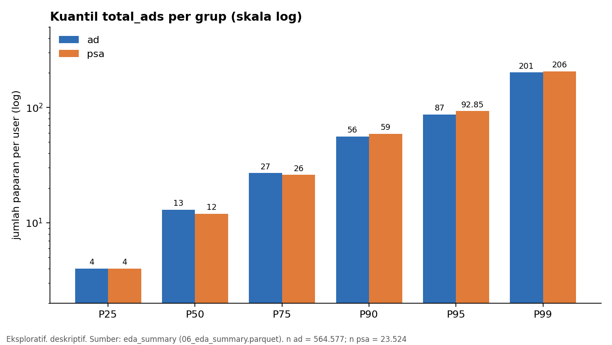
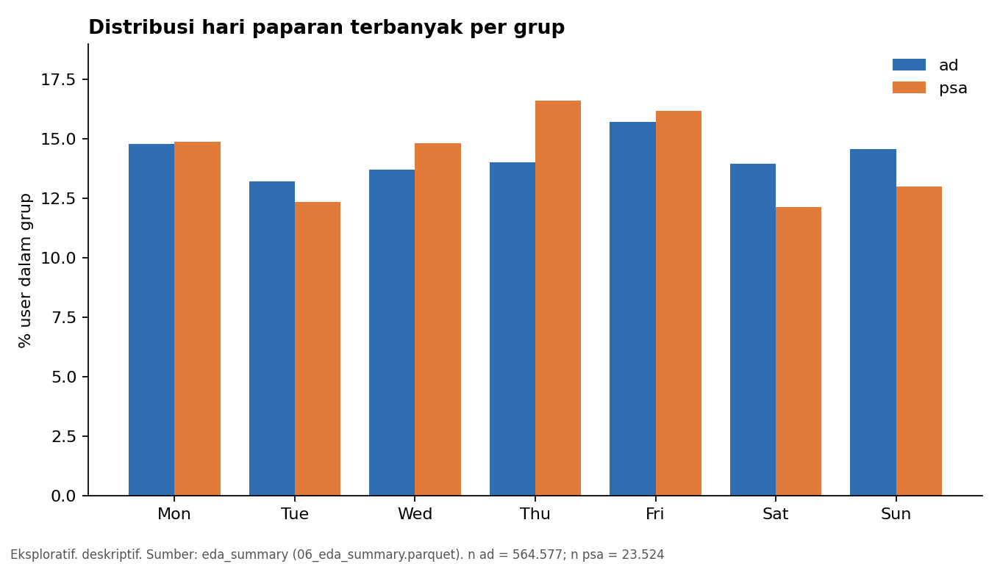
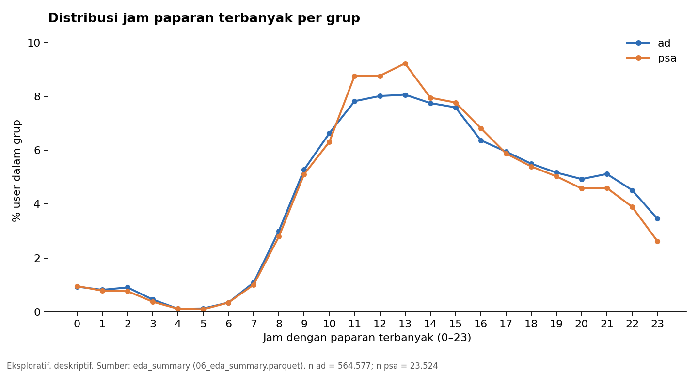
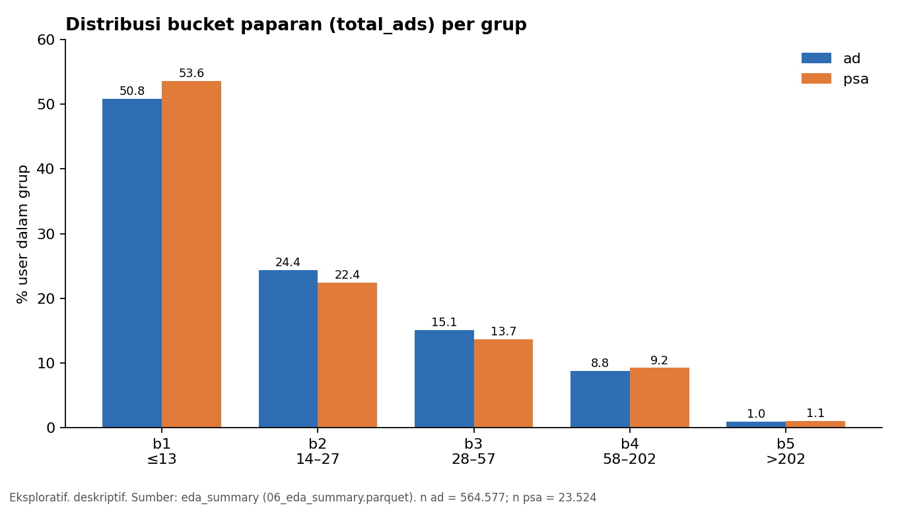

# 06 — Exploratory Data Analysis (EDA)

> Pendamping: `sql/06_eda.sql` · Tahap 7 (Jalur Inti)
> **Seluruh isi dokumen ini berlabel *exploratory*.** Tidak ada uji hipotesis dan tidak ada kesimpulan kausal di tahap ini; inferensi dikerjakan di Tahap 8 sesuai D1–D9 (`docs/methodology.md`, tag `kpi-lock`).

## Input

- `marketing_ab_clean` (Valid Analysis Population = 588.101 user; 564.577 `ad` dan 23.524 `psa`).
- Populasi per analisis: Valid Analysis Population (ukuran grup dan konversi), Exposure Population (`total_ads`, bucket), Time Population (hari, blok waktu, jam). Ketiganya berukuran 588.101.

## Proses Analisis

1. Ukuran grup, jumlah dan persentase konversi per grup.
2. Distribusi `total_ads` per grup (rata-rata, SD, P25–P99, maksimum, rasio rata-rata terhadap median).
3. Ekor panjang dan outlier `total_ads`: ambang gabungan (P99, pagar Tukey), lima nilai tertinggi per grup (tanpa `converted`). Hanya ditandai, tidak ada yang dibuang.
4. Distribusi hari, blok waktu, jam, dan bucket paparan per grup (share di dalam grup).
5. Keseimbangan antar grup: *total variation distance* (TVD) untuk variabel kategorikal dan *standardized mean difference* (SMD) untuk `total_ads`.
6. Rekonsiliasi dan ekspor `data/processed/06_eda_summary.parquet` (314 baris).

**Yang sengaja tidak dilakukan (EDA Governance):** tidak ada CR per bucket, hari, blok waktu, atau jam, sehingga segmen tidak dapat dipilih berdasarkan pola konversi (D4, D5). CR per segmen dikerjakan di Tahap 10–12.

## Temuan

### 1. Ukuran grup dan konversi (deskriptif)

| Grup | n user | n konversi | Persentase konversi | Porsi dari populasi valid |
|---|---:|---:|---:|---:|
| `ad` | 564.577 | 14.423 | 2,5547% | 96,0% |
| `psa` | 23.524 | 420 | 1,7854% | 4,0% |
| Gabungan | 588.101 | 14.843 | 2,5239% | 100% |

Persentase konversi `ad` secara deskriptif lebih tinggi daripada `psa`, tetapi **belum diuji**. Kesimpulan statistik, selisih, CI, dan MDE ada di Tahap 8.

### 2. Distribusi `total_ads` per grup

| Grup | n | Rata-rata | SD | P25 | Median | P75 | P90 | P95 | P99 | Maks | Mean / median |
|---|---:|---:|---:|---:|---:|---:|---:|---:|---:|---:|---:|
| `ad` | 564.577 | 24,82 | 43,75 | 4 | 13 | 27 | 56 | 87 | 201 | 2.065 | 1,91 |
| `psa` | 23.524 | 24,76 | 42,86 | 4 | 12 | 26 | 59 | 92,85 | 206 | 907 | 2,06 |
| Gabungan | 588.101 | 24,82 | 43,72 | 4 | 13 | 27 | 57 | 88 | 202 | 2.065 | 1,91 |

- Kedua grup memiliki bentuk distribusi yang sangat mirip. SMD rata-rata `total_ads` antara `ad` dan `psa` = **0,0014** (praktis nol).
- Distribusi **sangat menjulur ke kanan**: rata-rata sekitar 1,9–2,1 kali median, dan maksimum jauh di atas P99.
- Maksimum `ad` (2.065) lebih besar daripada `psa` (907), tetapi `ad` berisi sekitar 24 kali lebih banyak user. Nilai maksimum sampel cenderung naik seiring ukuran sampel, sementara kuantil sampai P99 hampir identik antar grup.

### 3. Ekor panjang dan outlier `total_ads`

Ambang (populasi gabungan): Q1 = 4, Q3 = 27, IQR = 23, P99 = 202, pagar Tukey atas = 61,5, pagar ekstrem = 96,0.

| Grup | n | > P99 (n) | > P99 (%) | > pagar Tukey (n) | > pagar Tukey (%) | > pagar ekstrem (n) | Porsi total paparan dari user > P99 |
|---|---:|---:|---:|---:|---:|---:|---:|
| `ad` | 564.577 | 5.560 | 0,985% | 49.861 | 8,832% | 23.730 | 12,99% |
| `psa` | 23.524 | 250 | 1,063% | 2.196 | 9,335% | 1.095 | 13,14% |
| Gabungan | 588.101 | 5.810 | 0,988% | 52.057 | 8,852% | 24.825 | 12,99% |

Lima nilai tertinggi (tanpa `converted`): `ad` = 2.065; 1.778; 1.680; 1.632; 1.491. `psa` = 907; 809; 760; 727; 646.

- Sekitar **1% user teratas menyumbang sekitar 13% dari seluruh paparan** di kedua grup.
- Pagar Tukey menandai ± 8,9% user. Untuk data cacah yang menjulur sangat ke kanan, angka ini mencerminkan **ekor yang memang berat**, bukan 8,9% data yang salah. Tidak ada nilai yang tidak mungkin (minimum = 1, semua bilangan bulat).
- **Tidak ada baris yang dibuang.** Ekor ditangani lewat bucket berbasis kuantil (D4), sesuai keputusan yang sudah terkunci.

### 4. Distribusi hari, blok waktu, jam, bucket

Selisih = persentase `ad` dikurangi persentase `psa`, dalam poin persentase (pp).

**Hari**

| Hari | % `ad` | % `psa` | Selisih (pp) |
|---|---:|---:|---:|
| Monday | 14,80 | 14,89 | −0,08 |
| Tuesday | 13,21 | 12,36 | +0,85 |
| Wednesday | 13,71 | 14,84 | −1,12 |
| Thursday | 14,01 | 16,60 | **−2,59** |
| Friday | 15,73 | 16,17 | −0,44 |
| Saturday | 13,96 | 12,15 | +1,81 |
| Sunday | 14,58 | 13,00 | +1,58 |

**Blok waktu**

| Blok | n `ad` | % `ad` | n `psa` | % `psa` | Selisih (pp) |
|---|---:|---:|---:|---:|---:|
| 00–05 | 19.102 | 3,38 | 735 | 3,12 | +0,26 |
| 06–11 | 136.526 | 24,18 | 5.727 | 24,35 | −0,16 |
| 12–17 | 246.925 | 43,74 | 10.914 | 46,40 | **−2,66** |
| 18–23 | 162.024 | 28,70 | 6.148 | 26,14 | **+2,56** |

**Jam:** puncak di jam 11–13 (sekitar 8–9% user per jam), sangat sedikit di jam 3–6 (di bawah 0,5% per jam). Selisih antar grup terbesar: jam 13 (−1,17 pp), jam 11 (−0,94 pp), jam 23 (+0,83 pp), jam 12 (−0,74 pp).

**Bucket paparan**

| Bucket | % `ad` | % `psa` | Selisih (pp) |
|---|---:|---:|---:|
| b1 (≤ 13) | 50,82 | 53,57 | −2,75 |
| b2 (14–27) | 24,35 | 22,42 | +1,93 |
| b3 (28–57) | 15,09 | 13,71 | +1,38 |
| b4 (58–202) | 8,76 | 9,25 | −0,49 |
| b5 (> 202) | 0,98 | 1,06 | −0,08 |

### 5. Keseimbangan antar grup

| Dimensi | Ukuran | Nilai |
|---|---|---:|
| `total_ads` (rata-rata) | SMD | 0,0014 |
| Blok waktu (4 kategori) | TVD | 2,82% |
| Bucket paparan (5 kategori) | TVD | 3,31% |
| Jam (24 kategori) | TVD | 3,70% |
| Hari (7 kategori) | TVD | 4,24% |

TVD = proporsi massa distribusi yang harus dipindahkan agar kedua distribusi identik (0% = identik).

- Rata-rata `total_ads` hampir identik antar grup (SMD ≈ 0), tetapi **komposisi waktu dan bucket sedikit berbeda** (TVD sekitar 3–4%).
- `psa` condong ke siang hari (blok 12–17) dan hari Kamis; `ad` condong ke malam (blok 18–23) serta akhir pekan.
- Sebagai skala: galat baku untuk selisih share sekitar 14–17% antara kedua grup kira-kira 0,2–0,3 pp (karena `psa` kecil). Selisih sebesar 1–2,6 pp berada jauh di atas skala itu, sehingga pola ini kemungkinan **bukan sekadar derau sampling**. Ini hanya penilaian kasar, bukan uji formal.
- Karena `total_ads`, hari, dan jam adalah **variabel post-treatment (D7)**, perbedaan komposisi ini **bukan bukti** pelanggaran randomization. Perbedaan bisa muncul dari treatment itu sendiri atau dari cara kedua materi disajikan.

### 6. Rekonsiliasi

Jumlah user per kategori (hari, blok, jam, bucket) sama dengan ukuran grup untuk `ad` (564.577), `psa` (23.524), dan gabungan (588.101): seluruhnya **MATCH**. Parquet `06_eda_summary.parquet` = tabel `eda_summary` (314 = 314, MATCH).

## Hipotesis kandidat (*exploratory*)

Pertanyaan untuk tahap selanjutnya. Tidak ada yang mengubah KPI, populasi, bucket, atau keputusan D1–D9, dan tidak ada yang menjadi kesimpulan sampai diuji dengan aturan yang sudah terkunci.

| ID | Kandidat | Tahap tujuan | Catatan |
|---|---|---|---|
| H-c1 | Komposisi waktu paparan berbeda antar grup (`psa` lebih ke siang dan Kamis; `ad` lebih ke malam dan akhir pekan). Jika CR bervariasi menurut waktu, perbandingan agregat bisa tercampur komposisi | 11–12 | Pemeriksaan Simpson's paradox di Tahap 12 menjadi relevan. Hanya asosiasi (D7) |
| H-c2 | Apakah CR berasosiasi dengan frekuensi paparan (bucket)? | 10 | Bucket sudah dikunci (D4). Sel `b5` × `psa` (250 user) tidak akan diinterpretasikan (D5, K1) |
| H-c3 | Apakah user paparan sangat tinggi (1% teratas, ± 13% dari seluruh paparan) berperilaku berbeda? | 10 | Hanya deskriptif karena sel kecil di `psa` |

## Output

- `data/processed/06_eda_summary.parquet` (314 baris; tidak di-commit karena diabaikan `.gitignore`, dapat dibuat ulang lewat skrip).
- Tabel `eda_summary` di `ab_testing.duckdb`.
- Empat grafik di `docs/figures/` (`eda_01` sampai `eda_04`).
- `sql/06_eda.sql` dan dokumen ini.

## Assumptions

- Distribusi dihitung sebagai persentase user di dalam grup masing-masing, supaya grup `ad` dan `psa` yang berukuran sangat berbeda dapat dibandingkan.
- Ambang ekor memakai populasi gabungan, jadi kedua grup dinilai dengan batas yang sama.
- Pagar Tukey dipakai hanya sebagai penanda deskriptif, bukan aturan pembuangan data.
- Grafik dibuat dari angka hasil `eda_summary` (E2, E4, E6, E7) dan bersifat eksploratif.

## Batasan data

- `total_ads`, hari, dan jam adalah variabel post-treatment (D7); keseimbangannya tidak menguji randomization.
- `most_ads_day` dan `most_ads_hour` hanya satu nilai per user, bukan log per paparan.
- Grup `psa` kecil (4%), sehingga persentase `psa` per kategori punya ketidakpastian lebih besar, khususnya jam dini hari.
- Tidak ada timestamp assignment atau konversi.
- Penilaian "di atas derau" pada bagian 5 adalah perkiraan kasar, bukan hasil uji.

## Kesimpulan

Tidak ditemukan masalah data baru, jadi tidak ada alasan kembali ke Tahap 5 atau 6 dan tidak ada perubahan pada KPI maupun populasi (D1–D9 tetap sesuai `kpi-lock`).

Temuan eksploratif: (1) distribusi `total_ads` sangat menjulur ke kanan dan hampir identik antar grup (SMD ≈ 0, 1% teratas menyumbang ± 13% paparan); (2) komposisi hari, jam, dan bucket berbeda sedikit antar grup (TVD 2,8–4,2%), dengan `psa` condong ke siang dan Kamis; (3) persentase konversi `ad` secara deskriptif lebih tinggi daripada `psa`, tetapi belum diuji. Tahap 8 menguji perbedaan itu persis sesuai D1–D9.
