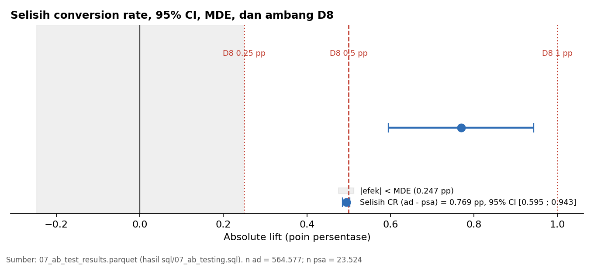

# 07 — A/B Testing & Statistical Validation

> Pendamping: `sql/07_ab_testing.sql` · Tahap 8 (Jalur Inti)
> Seluruh analisis mengikuti **D1–D9 dan K1–K5** di `docs/methodology.md` (git tag `kpi-lock`). Metode, α, dan definisi KPI tidak diubah setelah melihat hasil. Primary test bersifat *confirmatory*.

## Input

- `marketing_ab_clean` (Valid Analysis Population = 588.101 user; 564.577 `ad` dan 23.524 `psa`) dan `validation_summary` (Tahap 6).
- Parameter terkunci: uji dua arah, α = 0,05 (D1); z-test primer, chi-square dan Fisher sebagai sensitivitas (D2); ambang D8 = 0,25 / 0,5 / 1,0 poin persentase; MDE dengan power 80% (K4).

## Proses Analisis

Seluruhnya di DuckDB SQL (`sql/07_ab_testing.sql`); rumus dan fungsi dicatat di `docs/methodology.md` bagian 6A.

1. Hitungan dasar: n, konversi, CR per grup, absolute dan relative lift; cross-check ke `validation_summary`.
2. Uji primer: two-proportion z-test dua arah (statistik uji pooled), CI 95% selisih (Wald tak-pooled), CI relative lift (log risk ratio / Katz).
3. Sensitivitas: chi-square tanpa koreksi kontinuitas, Fisher exact dua arah, dan z-test tanpa duplikat (D3).
4. MDE retrospektif (power 80%, α = 0,05 dua arah, baseline = CR `psa`, hanya memakai $n_{ad}$, $n_{psa}$, dan $CR_{psa}$).
5. Practical significance (D8): batas CI dibandingkan dengan tiga ambang.
6. Pemeriksaan asumsi dan interpretasi D9.
7. Pemeriksaan otomatis (10 pemeriksaan, termasuk self-test macro normal) dan ekspor `data/processed/07_ab_test_results.parquet`.

## Temuan

### 1. Hitungan dasar

| Grup | n user | n konversi | CR |
|---|---:|---:|---:|
| `ad` (treatment) | 564.577 | 14.423 | 2,5547% |
| `psa` (control) | 23.524 | 420 | 1,7854% |

Hitungan ini identik dengan `validation_summary` (E05, E06, B02, B03: semua PASS).

### 2. Uji primer (D1, D2)

| Metrik | Nilai |
|---|---|
| Absolute lift (`ad` − `psa`) | **0,7692 pp** |
| 95% CI selisih (Wald, tak-pooled) | **0,5951 sampai 0,9434 pp** |
| Relative lift | 43,09% (95% CI 29,97% sampai 57,52%) |
| z (pooled) | 7,3701 |
| p-value dua arah | **1,705 × 10⁻¹³** |
| Keputusan statistik | p < α: ada bukti statistik untuk menolak $H_0$ |

### 3. Sensitivitas

| Metode | Statistik | p-value dua arah | Catatan |
|---|---:|---:|---|
| z-test primer (pooled) | 54,318052 ($z^2$) | 1,705 × 10⁻¹³ | |
| Chi-square (tanpa koreksi kontinuitas) | 54,318052 | 1,705 × 10⁻¹³ | df = 1 |
| Fisher exact (dua arah) | | 1,047 × 10⁻¹⁴ | odds ratio = 1,4421 |
| z-test tanpa duplikat (D3) | 54,318052 | 1,705 × 10⁻¹³ | 588.101 vs 588.101 user (0 dikeluarkan) |

Keempat metode memberi kesimpulan yang sama. Chi-square identik dengan $z^2$ (sesuai teori untuk tabel 2×2). p-value Fisher lebih kecil satu orde besaran daripada z-test; pada ekor sedekat ini, perbedaan antara uji eksak dan aproksimasi normal wajar, dan keduanya jauh di bawah α. D3 tidak berlaku (0 duplikat), sehingga hasilnya identik dengan hasil utama.

### 4. MDE retrospektif (K4)

| Metrik | Nilai |
|---|---|
| Baseline $CR_{psa}$ | 1,7854% |
| MDE absolut (power 80%, α = 0,05 dua arah) | **0,2475 pp** |
| MDE relatif terhadap $CR_{psa}$ | 13,86% |
| Aproksimasi $p_1 \approx p_0$ (verifikasi silang) | 0,2469 pp |
| Power pada δ = MDE (cek) | 0,800001 |
| Ambang D8 utama | 0,5 pp |

MDE (0,2475 pp) **lebih kecil** daripada ambang D8 (0,5 pp), sehingga desain ini cukup sensitif untuk mendeteksi efek seukuran ambang. Sebagai konsekuensinya, jika hasilnya tidak signifikan pun, pembacaannya tidak otomatis "inconclusive" menurut D9 (di eksperimen ini hasilnya signifikan).

### 5. Practical significance (D8)

| Ambang | Batas bawah CI | Batas atas CI | Verdict |
|---:|---:|---:|---|
| 0,25 pp | 0,5951 | 0,9434 | efek ≥ ambang (CI sepenuhnya di atas) |
| 0,50 pp | 0,5951 | 0,9434 | efek ≥ ambang (CI sepenuhnya di atas) |
| 1,00 pp | 0,5951 | 0,9434 | efek < ambang (CI sepenuhnya di bawah) |

Ambang D8 adalah **asumsi eksplisit**, bukan fakta bisnis: tidak ada data biaya, sehingga tidak ada ambang yang dapat diturunkan dari ROI. Efek yang terukur melampaui 0,25 dan 0,5 pp, tetapi tidak mencapai 1,0 pp.

### 6. Pemeriksaan asumsi

| Pemeriksaan | Nilai | Status |
|---|---|---|
| Aproksimasi normal: min(konversi, non-konversi) per grup ≥ 10 | 420 | terpenuhi |
| Chi-square: frekuensi harapan sel minimum ≥ 5 | 593,72 | terpenuhi |
| Independensi per user: `user_id` unik di populasi valid | 588.101 unik dari 588.101 | terpenuhi |
| Rasio ukuran grup `ad : psa` (deskriptif) | 24,0 | rasio desain tidak tersedia, SRM tidak dapat dinilai |
| Randomization | tidak dapat diverifikasi | limitation |

### 7. Validasi implementasi

| Pemeriksaan | Hasil |
|---|---|
| Self-test macro `ab_norm_sf` terhadap 15 nilai acuan | 15 dari 15 PASS; galat relatif maksimum $2{,}85 \times 10^{-14}$ |
| Pemeriksaan otomatis `ab_checks` (C01–C10) | **10 dari 10 PASS (ALL PASS)** |
| Chi-square = $z^2$ | galat relatif $7{,}8 \times 10^{-16}$ |
| p-value chi-square = p-value z-test | galat relatif $2{,}2 \times 10^{-14}$ |
| Jumlah probabilitas Fisher seluruh tabel = 1 | selisih $1{,}07 \times 10^{-9}$ |
| MDE: power pada δ = MDE vs 80% | selisih $9{,}6 \times 10^{-7}$ |
| Parquet `07_ab_test_results.parquet` = tabel | 27 = 27 (MATCH) |

## Interpretasi (D9)

1. **Signifikansi statistik.** Ada bukti statistik yang kuat untuk menolak $H_0$ (CR `ad` dan `psa` sama): z = 7,37 dan p ≈ 1,7 × 10⁻¹³ (dua arah, α = 0,05). Hasil ini konsisten di chi-square, Fisher exact, dan analisis tanpa duplikat.
2. **Ukuran efek dan ketidakpastian.** CR `ad` lebih tinggi daripada `psa` sebesar 0,77 poin persentase (95% CI 0,60 sampai 0,94 pp), atau relative lift sekitar 43% (95% CI 30% sampai 58%). Dalam skala absolut, kedua CR rendah (2,55% dan 1,79%).
3. **Kecukupan desain.** MDE retrospektif 0,25 pp lebih kecil dari ambang D8 (0,5 pp) dan lebih kecil dari selisih yang teramati, sehingga ukuran sampel, termasuk grup `psa` yang kecil, cukup untuk mendeteksi efek seukuran ini.
4. **Practical significance.** Seluruh 95% CI berada di atas 0,25 dan 0,5 pp (efek ≥ ambang pada kedua ambang) dan di bawah 1,0 pp. Kesimpulan ini bersyarat pada ambang D8 yang merupakan asumsi.
5. **Signifikansi statistik tidak sama dengan dampak bisnis.** Tanpa data biaya atau nilai transaksi, hasil ini tidak menyatakan apakah kampanye menguntungkan, dan tidak boleh dibaca sebagai ROI.
6. **Batas kausal.** Selisih CR ditafsirkan sebagai efek penugasan grup hanya jika randomization valid. Randomization tidak dapat diverifikasi dari dataset, rasio grup 24 : 1, dan rasio desain tidak diketahui sehingga SRM tidak dapat dinilai.

## Output

- `sql/07_ab_testing.sql` dan dokumen ini.
- Tabel `ab_test_results`, `ab_primary`, `ab_chi`, `ab_fisher`, `ab_mde`, `ab_d8`, `ab_interpretation`, `ab_checks` di `ab_testing.duckdb`.
- `data/processed/07_ab_test_results.parquet` (27 metrik; tidak di-commit karena diabaikan `.gitignore`, dapat dibuat ulang lewat skrip).
- `docs/figures/ab_01_lift_ci.png` (gambar statis dari hasil SQL).
- Pembaruan `docs/methodology.md`: bagian 6A (rumus dan fungsi), redaksi K4, dan entri Revision Log.

## Assumptions

- Seluruh keputusan statistik adalah yang terkunci (D1–D9, K1–K5); tidak ada yang berubah setelah melihat hasil.
- Konstanta kuantil normal baku ($z_{0{,}975}$ dan $z_{0{,}80}$) ditulis sebagai konstanta karena DuckDB tidak punya fungsi kuantil normal. Fungsi survival normal ditulis sebagai macro dan divalidasi terhadap nilai acuan eksternal.
- Fisher exact dua arah memakai kriteria "tabel yang tidak lebih mungkin daripada tabel teramati" dengan toleransi relatif $10^{-7}$.
- Ambang D8 (0,25 / 0,5 / 1,0 pp) adalah asumsi eksplisit.

## Batasan data

- Randomization tidak dapat diverifikasi; rasio desain grup tidak tersedia.
- Tidak ada data biaya atau nilai transaksi: tidak ada ROI, ROAS, atau profit.
- Grup `psa` kecil (4%); desainnya masih cukup sensitif untuk efek 0,25 pp, tetapi analisis segmen `psa` sangat terbatas (D5).
- Satu eksperimen dalam satu periode; tidak ada timestamp assignment atau konversi, sehingga novelty effect dan tren kalender tidak dapat dianalisis.
- Analisis ini hanya menjawab pertanyaan utama pada level agregat; temuan per segmen bersifat eksploratif dan ada di Tahap 10–12.

## Kesimpulan

Pada Valid Analysis Population (588.101 user), conversion rate kelompok `ad` (2,5547%) lebih tinggi daripada kelompok `psa` (1,7854%) dengan selisih 0,77 pp (95% CI 0,60 sampai 0,94 pp; p ≈ 1,7 × 10⁻¹³). Hasilnya konsisten di semua uji sensitivitas, memenuhi ambang practical significance 0,25 dan 0,5 pp (tidak 1,0 pp), dan desain memiliki MDE 0,25 pp. Seluruh 10 pemeriksaan otomatis lolos.

Kesimpulan kausal bersyarat pada validitas randomization yang tidak dapat diverifikasi, dan dampak finansial tidak dapat dinilai tanpa data biaya.
