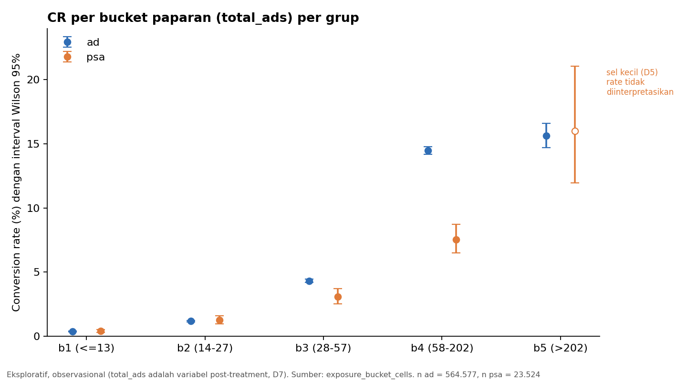

# 09 — Exposure Frequency Analysis

> Pendamping: `sql/09_exposure_frequency.sql` · Tahap 10 (Jalur Lanjutan)
> **Seluruh isi dokumen ini berlabel *exploratory* dan observasional.** Bucket mengikuti D4 (terkunci); tidak ada uji lift per bucket (D6); sel kecil mengikuti D5; `total_ads` adalah variabel post-treatment (D7), sehingga tidak ada klaim sebab-akibat.

## Input

- `marketing_ab_clean` dengan kolom `exposure_bucket` (Exposure Population = 588.101 user; 564.577 `ad` dan 23.524 `psa`).
- Bucket (D4): b1 ≤ 13, b2 14–27, b3 28–57, b4 58–202, b5 > 202 (batas P50, P75, P90, P99 dari populasi gabungan).

## Proses Analisis

1. CR per bucket × grup (dan gabungan), dengan n dan jumlah konversi di samping setiap rate, serta interval Wilson 95% (K3).
2. Distribusi bucket antar grup dan verifikasi rentang `total_ads` per bucket.
3. Selisih CR `ad` − `psa` per bucket (titik, tanpa uji), hanya jika kedua sel lolos D5.
4. Tren CR antar bucket dalam grup (hipotesis diminishing returns): indeks terhadap b1, perubahan antar bucket, dan penanda apakah kenaikan menyusut.
5. Rekonsiliasi (11 pemeriksaan) dan penandaan sel kecil (D5: < 500 user atau < 30 konversi).

## Temuan

### 1. CR per bucket per grup

| Bucket | Grup | n user | n konversi | CR | Wilson 95% | % user grup | % konversi grup | D5 |
|---|---|---:|---:|---:|---|---:|---:|---|
| b1 (≤ 13) | `ad` | 286.895 | 1.079 | 0,3761% | 0,354–0,399 | 50,82 | 7,48 | ok |
| b1 | `psa` | 12.601 | 51 | 0,4047% | 0,308–0,532 | 53,57 | 12,14 | ok |
| b2 (14–27) | `ad` | 137.483 | 1.631 | 1,1863% | 1,130–1,245 | 24,35 | 11,31 | ok |
| b2 | `psa` | 5.274 | 66 | 1,2514% | 0,985–1,589 | 22,42 | 15,71 | ok |
| b3 (28–57) | `ad` | 85.178 | 3.680 | 4,3204% | 4,186–4,459 | 15,09 | 25,51 | ok |
| b3 | `psa` | 3.224 | 99 | 3,0707% | 2,529–3,724 | 13,71 | 23,57 | ok |
| b4 (58–202) | `ad` | 49.461 | 7.164 | 14,4841% | 14,177–14,797 | 8,76 | 49,67 | ok |
| b4 | `psa` | 2.175 | 164 | 7,5402% | 6,504–8,726 | 9,25 | 39,05 | ok |
| b5 (> 202) | `ad` | 5.560 | 869 | 15,6295% | 14,699–16,608 | 0,98 | 6,03 | ok |
| b5 | `psa` | 250 | 40 | 16,0000% | 11,975–21,054 | 1,06 | 9,52 | **kecil (n < 500)** |

Satu-satunya sel kecil adalah `b5` × `psa` (250 user). Rate-nya ditampilkan tetapi **tidak diinterpretasikan** dan tidak dipakai dalam selisih maupun tren (D5, K1).

### 2. CR naik tajam menurut frekuensi paparan di kedua grup

| Grup | CR b1 | b2 | b3 | b4 | b5 |
|---|---:|---:|---:|---:|---:|
| `ad` | 0,376% | 1,186% | 4,320% | 14,484% | 15,630% |
| indeks terhadap b1 | 1,0 | 3,2 | 11,5 | 38,5 | 41,6 |
| `psa` | 0,405% | 1,251% | 3,071% | 7,540% | (tidak diinterpretasikan) |
| indeks terhadap b1 | 1,0 | 3,1 | 7,6 | 18,6 | |

Hubungan positif yang kuat muncul **di kedua grup**, termasuk di `psa` yang paparannya adalah PSA. Ini menunjukkan bahwa tingginya jumlah paparan berasosiasi dengan tingginya konversi terlepas dari jenis materi, yang konsisten dengan pembacaan bahwa user yang lebih aktif memiliki paparan dan konversi yang lebih tinggi (lihat bagian Interpretasi).

### 3. Hipotesis diminishing returns (grup `ad`)

| Perpindahan | Perubahan CR (pp) | Kenaikan menyusut? |
|---|---:|---|
| b1 → b2 | +0,81 | (belum ada pembanding) |
| b2 → b3 | +3,13 | tidak |
| b3 → b4 | +10,16 | tidak |
| b4 → b5 | +1,15 | **ya** |

Kenaikan CR **tidak menyusut** sampai bucket b4 (hingga P99). Penyusutan baru terlihat di atas P99 (b4 → b5: +1,15 pp), yaitu kurva mendatar di ujung atas. Untuk `psa`, perpindahan b4 → b5 tidak dapat dinilai karena sel kecil.

### 4. Selisih `ad` − `psa` per bucket (titik, tanpa uji)

| Bucket | CR `ad` | CR `psa` | Selisih (pp) | Interval Wilson |
|---|---:|---:|---:|---|
| b1 | 0,3761% | 0,4047% | −0,03 | tumpang tindih |
| b2 | 1,1863% | 1,2514% | −0,07 | tumpang tindih |
| b3 | 4,3204% | 3,0707% | **+1,25** | tidak tumpang tindih |
| b4 | 14,4841% | 7,5402% | **+6,94** | tidak tumpang tindih |
| b5 | 15,6295% | (sel kecil) | tidak diinterpretasikan | |

Keterangan tumpang tindih adalah pengamatan deskriptif, bukan uji (D6). Di b1 dan b2 CR kedua grup hampir sama (selisih kecil dan interval tumpang tindih); selisih besar muncul di b3 dan terutama b4.

### 5. Dari mana selisih agregat berasal

Selisih agregat 0,7692 pp dapat dipecah per bucket sebagai $x_{ad,k}/n_{ad} - x_{psa,k}/n_{psa}$ (aritmetika dari jumlah konversi pada tabel 1, bukan uji):

| Bucket | Kontribusi (pp) | Porsi dari selisih total |
|---|---:|---:|
| b1 | −0,026 | −3,3% |
| b2 | +0,008 | +1,1% |
| b3 | +0,231 | +30,0% |
| b4 | **+0,572** | **+74,3%** |
| b5 | −0,016 | −2,1% |
| **Total** | **0,769** | 100% |

Sekitar 104% dari selisih agregat berasal dari bucket b3 dan b4, sementara b1, b2, dan b5 secara netto sedikit negatif. Kontribusi b5 adalah hasil pemecahan aritmetika; sel `psa` b5 tetap tidak diinterpretasikan.

### 6. Konsentrasi konversi dan distribusi antar grup

- Di grup `ad`, bucket b4 dan b5 (9,75% user) menghasilkan **55,7%** konversi; bucket b1 (50,8% user) hanya 7,5% konversi.
- Sekitar 1% user teratas (b5, 5.560 user `ad`) menghasilkan 6,03% konversi `ad`, padahal pada EDA user ini menyumbang sekitar 13% total paparan. CR b5 (15,63%) hanya sedikit di atas b4 (14,48%).
- Distribusi bucket antar grup mirip: `psa` sedikit lebih banyak di b1 (53,57% vs 50,82%), selisih paling besar 2,75 pp.

### 7. Rekonsiliasi

11 dari 11 pemeriksaan **PASS** (ALL PASS): SUM(n) per bucket = Exposure Population (564.577; 23.524; 588.101), SUM(konversi) = hasil Tahap 8 (14.423 dan 420), sel ALL = `ad` + `psa`, CR berada di dalam interval Wilson-nya, batas Wilson dalam [0, 1], rentang bucket tidak tumpang tindih, dan jumlah bucket = 5.

## Interpretasi (eksploratif)

1. **CR sangat berasosiasi dengan jumlah paparan** di kedua grup (0,38% di b1 sampai 14,5% di b4 pada grup `ad`). Ini hubungan **observasional**: user yang lebih aktif cenderung terpapar lebih banyak iklan **dan** lebih mungkin konversi, sehingga gradien ini sangat mungkin mencerminkan aktivitas user, bukan efek iklan (D7). Tanpa timestamp, urutan waktu antara paparan dan konversi juga tidak dapat diperiksa.
2. **Perbandingan `ad` vs `psa` di dalam bucket bukan estimasi kausal**, karena bucket dibentuk dari `total_ads` yang merupakan variabel post-treatment. D7 melarang `total_ads` dipakai sebagai kovariat penyesuai efek utama, dan analisis ini tidak melakukannya.
3. **Selisih agregat tidak merata antar bucket.** Selisih terkonsentrasi di b3 dan b4 (user dengan paparan sedang-tinggi), sedangkan di b1 dan b2 kedua grup hampir sama. Belum ada pembalikan arah yang berarti (selisih negatif di b1 dan b2 sangat kecil dan interval tumpang tindih), sehingga tidak ada tanda Simpson's paradox pada bucket yang dapat dibaca. Namun heterogenitasnya penting untuk pemeriksaan di Tahap 12.
4. **Diminishing returns** hanya tampak di ujung atas (di atas P99) pada grup `ad`; sebelum itu CR naik semakin cepat.

## Status hipotesis kandidat (dari EDA)

| ID | Pertanyaan | Hasil eksploratif |
|---|---|---|
| H-c2 | Apakah CR berasosiasi dengan frekuensi paparan? | **Ya**, sangat kuat dan di kedua grup. Asosiasi observasional saja (D7) |
| H-c3 | Apakah user paparan sangat tinggi (1% teratas) berperilaku berbeda? | CR b5 sedikit di atas b4 (kurva mendatar), 6,03% konversi `ad` dari 0,98% user. Sel `psa` terlalu kecil (250 user), tidak diinterpretasikan |

## Output

- Tabel `exposure_bucket_cells`, `exposure_bucket_compare`, `exposure_trend`, `exposure_checks` di `ab_testing.duckdb`, plus macro `ab_wilson_low` dan `ab_wilson_high`.
- `sql/09_exposure_frequency.sql`, dokumen ini, dan `docs/figures/exposure_01_cr_by_bucket.png` (gambar statis dari hasil SQL).
- Tidak ada ekspor Parquet di tahap ini; mart untuk dashboard dibuat di Tahap 13.

## Assumptions

- Seluruh analisis eksploratif dan memakai keputusan terkunci: bucket D4, ambang sel kecil D5, tanpa uji lift per bucket (D6), `total_ads` sebagai variabel post-treatment (D7), interval Wilson untuk CR segmen (K3).
- Keterangan "interval tumpang tindih atau tidak" adalah penanda deskriptif, bukan uji hipotesis.
- Dekomposisi pada bagian 5 adalah aritmetika dari jumlah konversi, bukan model.

## Batasan data

- `total_ads` adalah variabel post-treatment; aktivitas user tidak teramati dan tidak dapat dikendalikan.
- Tidak ada timestamp, sehingga urutan paparan dan konversi (termasuk kemungkinan arah sebaliknya) tidak dapat diperiksa.
- Sel `b5` × `psa` (250 user) tidak dapat diinterpretasikan; perbandingan di bucket teratas tidak tersedia.
- Randomization tidak dapat diverifikasi dan rasio grup ± 24 : 1.

## Kesimpulan

CR meningkat tajam menurut frekuensi paparan di kedua grup, dari kurang dari 0,5% di bucket terendah menjadi sekitar 14–15% di bucket tinggi. Karena hubungan ini observasional dan `total_ads` adalah variabel post-treatment, temuan ini tidak boleh dibaca sebagai "lebih banyak iklan menyebabkan lebih banyak konversi". Selisih CR `ad` vs `psa` tidak merata: hampir nol di bucket paparan rendah (b1, b2) dan terkonsentrasi di bucket sedang-tinggi (b3, b4), yang menyumbang sekitar 104% dari selisih agregat. Pola ini dibawa ke Tahap 11 dan 12 untuk diperiksa konsistensinya terhadap segmen waktu dan pemeriksaan Simpson's paradox.
