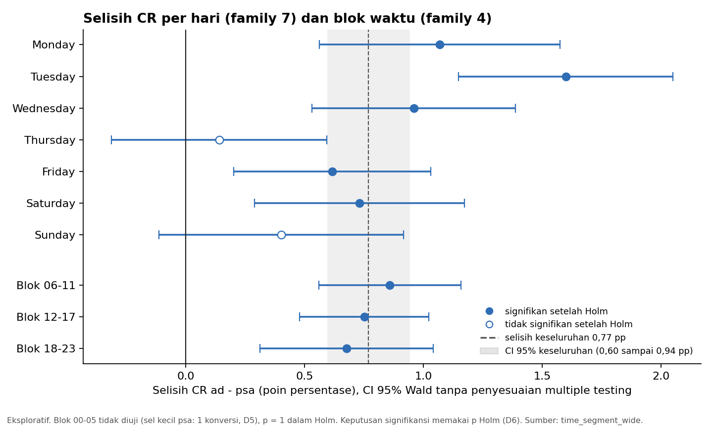
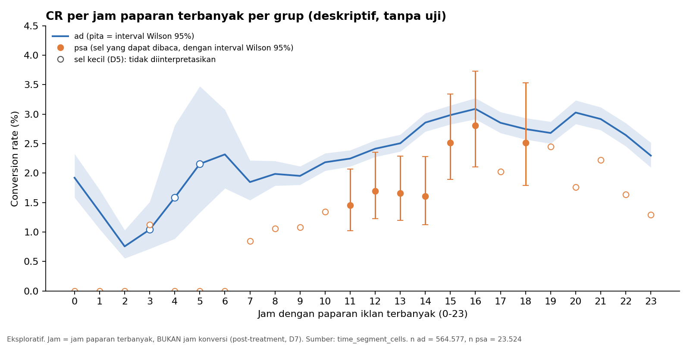

# 10 — Time Segments Analysis (Hari, Blok Waktu, Jam)

> Pendamping: `sql/10_time_segments.sql` · Tahap 11 (Jalur Lanjutan)
> **Seluruh isi dokumen ini berlabel *exploratory*.** Aturan yang dipakai adalah yang terkunci: blok waktu D4, sel kecil D5, uji lift hanya untuk hari (family 7) dan blok waktu (family 4) dengan koreksi Holm (D6, K2), interval Wilson untuk CR segmen (K3), dan hari serta jam sebagai variabel post-treatment (D7).

## Input

- `marketing_ab_clean` (Time Population = 588.101 user; 564.577 `ad` dan 23.524 `psa`).
- Segmen: 7 hari (`most_ads_day`), 4 blok waktu (00–05, 06–11, 12–17, 18–23), dan 24 jam (`most_ads_hour`).
- Catatan: `most_ads_day` dan `most_ads_hour` adalah hari dan jam dengan **paparan iklan terbanyak** per user, **bukan** waktu terjadinya konversi (tidak ada timestamp konversi).

## Proses Analisis

1. CR per segmen × grup, dengan n dan jumlah konversi di samping setiap rate, interval Wilson 95%, distribusi user antar grup, dan flag sel kecil D5.
2. Uji lift per hari (family 7) dan per blok waktu (family 4): two-proportion z-test dua arah (statistik pooled, sama dengan uji primer), CI selisih Wald tak-pooled (tidak disesuaikan untuk multiple testing), dan koreksi **Holm** per family.
3. Segmen yang tidak dapat diuji karena sel kecil diberi p = 1 dalam Holm dan tetap dihitung dalam ukuran family (K2).
4. Jam: deskriptif saja (CR dan CI per grup), tanpa uji per jam (D6).
5. Rekonsiliasi dan 20 pemeriksaan otomatis.

## Temuan

### 1. Hari (family 7, Holm)

| Hari | n `ad` | Konv `ad` | CR `ad` | n `psa` | Konv `psa` | CR `psa` | Selisih (pp) | 95% CI selisih | p mentah | p Holm | Hasil |
|---|---:|---:|---:|---:|---:|---:|---:|---|---:|---:|---|
| Monday | 83.571 | 2.778 | 3,3241% | 3.502 | 79 | 2,2559% | +1,07 | 0,56 – 1,57 | 5,08 × 10⁻⁴ | 2,54 × 10⁻³ | signifikan |
| Tuesday | 74.572 | 2.270 | 3,0440% | 2.907 | 42 | 1,4448% | +1,60 | 1,15 – 2,05 | 6,63 × 10⁻⁷ | 4,64 × 10⁻⁶ | signifikan |
| Wednesday | 77.418 | 1.963 | 2,5356% | 3.490 | 55 | 1,5759% | +0,96 | 0,53 – 1,39 | 3,76 × 10⁻⁴ | 2,26 × 10⁻³ | signifikan |
| Thursday | 79.077 | 1.711 | 2,1637% | 3.905 | 79 | 2,0230% | +0,14 | −0,31 – 0,59 | 0,555 | 0,555 | **tidak signifikan** |
| Friday | 88.805 | 1.995 | 2,2465% | 3.803 | 62 | 1,6303% | +0,62 | 0,20 – 1,03 | 0,0116 | 0,0347 | signifikan |
| Saturday | 78.802 | 1.679 | 2,1307% | 2.858 | 40 | 1,3996% | +0,73 | 0,29 – 1,17 | 0,00748 | 0,0299 | signifikan |
| Sunday | 82.332 | 2.027 | 2,4620% | 3.059 | 63 | 2,0595% | +0,40 | −0,11 – 0,92 | 0,157 | 0,314 | **tidak signifikan** |

Seluruh 14 sel hari lolos D5 (tidak ada sel kecil), sehingga ketujuh hari diuji. Titik estimasi selisih **positif di semua hari** (rentang +0,14 sampai +1,60 pp). Setelah Holm, 5 dari 7 hari signifikan pada α = 0,05; Thursday dan Sunday tidak.

### 2. Blok waktu (family 4, Holm)

| Blok | n `ad` | Konv `ad` | CR `ad` | n `psa` | Konv `psa` | CR `psa` | Selisih (pp) | 95% CI selisih | p mentah | p Holm | Hasil |
|---|---:|---:|---:|---:|---:|---:|---:|---|---:|---:|---|
| 00–05 | 19.102 | 257 | 1,3454% | 735 | **1** | 0,1361% | tidak diuji | | | 1 | **sel kecil (D5)** |
| 06–11 | 136.526 | 2.889 | 2,1161% | 5.727 | 72 | 1,2572% | +0,86 | 0,56 – 1,16 | 8,19 × 10⁻⁶ | 2,46 × 10⁻⁵ | signifikan |
| 12–17 | 246.925 | 6.832 | 2,7668% | 10.914 | 220 | 2,0158% | +0,75 | 0,48 – 1,02 | 2,50 × 10⁻⁶ | 1,00 × 10⁻⁵ | signifikan |
| 18–23 | 162.024 | 4.445 | 2,7434% | 6.148 | 127 | 2,0657% | +0,68 | 0,31 – 1,04 | 1,34 × 10⁻³ | 2,68 × 10⁻³ | signifikan |

Blok 00–05 × `psa` hanya 1 konversi (735 user), sehingga tidak diuji dan diberi p = 1 dalam Holm. Ukuran family tetap 4 (K2), sehingga koreksi untuk tiga blok lain tetap konservatif. Ketiga blok yang diuji signifikan setelah Holm.

### 3. Jam (24, deskriptif saja)

- **Grup `ad`:** CR terendah pada jam 02 (0,757%) dan tertinggi pada jam 16 (3,089%). Dari dini hari ke siang CR bergerak naik dan mencapai sekitar 2,7–3,1% pada jam 14–21, lalu turun di jam 22–23 (2,65% dan 2,30%). Tiga sel `ad` kecil (jam 03, 04, 05; konversi 27, 11, 16) tidak diinterpretasikan.
- **Grup `psa`:** **17 dari 24 sel jam adalah sel kecil** (D5), sehingga hanya tujuh jam yang dapat dibaca: jam 11 sampai 16 dan jam 18. Pada jam-jam itu CR `psa` naik dari 1,46% (jam 11) ke 2,81% (jam 16).
- Pada ketujuh jam `psa` yang dapat dibaca, titik estimasi CR `ad` lebih tinggi daripada `psa` (selisih 0,23 sampai 1,25 pp). Interval Wilson di beberapa jam tumpang tindih; tidak ada uji per jam (D6).
- Distribusi user per jam antar grup mirip dengan temuan EDA (psa sedikit lebih ke jam 11–13, `ad` sedikit lebih ke jam 20–23).

### 4. Sel kecil (D5)

| Family | `ad` | `psa` |
|---|---|---|
| Hari (7 sel per grup) | 0 sel kecil | 0 sel kecil |
| Blok waktu (4 sel per grup) | 0 sel kecil | 1 sel kecil (00–05) |
| Jam (24 sel per grup) | 3 sel kecil | 17 sel kecil |

### 5. Rekonsiliasi dan pemeriksaan

- SUM(n) per family dan grup = Time Population (564.577 dan 23.524); SUM(konversi) per family sama dengan Tahap 8 (14.423 dan 420); jumlah segmen 7, 4, dan 24; ukuran family Holm 7 dan 4; p terkoreksi ≥ p mentah dan ≤ 1; segmen yang tidak diuji memiliki p Holm = 1; jam tidak memiliki uji; z² = chi-square dari frekuensi harapan (galat relatif terbesar ≈ 2 × 10⁻¹⁵).
- **Catatan perbaikan.** Pada run pertama, 19 dari 20 pemeriksaan lolos. Pemeriksaan T19 (CR sel berada di dalam interval Wilson-nya) gagal untuk satu sel: `psa` jam 00 (0 konversi dari 227 user). Penyebabnya galat floating point: batas bawah Wilson terhitung +1,7 × 10⁻¹⁸, padahal nilai eksaknya 0. Macro diperbaiki (batas eksak 0 untuk 0 konversi dan 1 untuk semua konversi) dan pemeriksaan diberi toleransi 10⁻¹². Tidak ada angka hasil yang berubah. Setelah perbaikan seluruh 20 pemeriksaan **PASS**.

## Interpretasi (eksploratif, dengan batas interpretasi kausal)

1. **Arah selisih konsisten.** Di semua tujuh hari dan ketiga blok yang diuji, CR `ad` lebih tinggi daripada `psa` secara titik estimasi. Selisih per segmen berkisar 0,14–1,60 pp (hari) dan 0,68–0,86 pp (blok), mengelilingi selisih keseluruhan 0,77 pp.
2. **Thursday dan Sunday tidak signifikan setelah Holm.** Itu berarti **bukti tidak cukup**, bukan bukti bahwa tidak ada efek pada hari tersebut (D9). Sampel `psa` per hari kecil (2.858–3.905 user; 40–79 konversi), sehingga CI lebar dan daya uji terbatas. Friday dan Saturday signifikan tetapi dekat dengan batas (p Holm 0,035 dan 0,030), sehingga kesimpulannya peka terhadap pilihan koreksi.
3. **Perbedaan antar segmen belum terbukti sebagai efek interaksi.** Tidak ada uji interaksi di analisis ini. Selisih terbesar (Tuesday, +1,60 pp) dan terkecil (Thursday, +0,14 pp) memang tampak berjauhan, tetapi perbedaan antar segmen tidak boleh dibaca sebagai bukti bahwa efek iklan bergantung pada hari.
4. **Pola jam adalah asosiasi, bukan jadwal optimal.** CR cenderung lebih tinggi pada user yang jam paparan terbanyaknya sore dan malam. Jam ini adalah **jam paparan terbanyak, bukan jam konversi**, dan merupakan variabel post-treatment (D7). User dengan pola aktivitas berbeda berbeda pula dalam jam paparan dan kecenderungan konversi. Temuan ini **tidak** dapat dibaca sebagai "iklan pada jam tertentu meningkatkan konversi".
5. **Komposisi waktu berbeda antar grup** (EDA: `psa` lebih ke siang dan Kamis, `ad` lebih ke malam dan akhir pekan). Konsistensi kesimpulan utama terhadap komposisi ini diperiksa di Tahap 12.
6. **Multiple testing.** Hasil per hari dan per blok adalah eksploratif, dikoreksi Holm dalam masing-masing family (7 dan 4). Pengujian per segmen tidak menggantikan uji primer (Tahap 8), dan CI selisih per segmen tidak disesuaikan untuk multiple testing.

## Output

- Tabel `time_segment_cells`, `time_segment_wide`, `time_checks` di `ab_testing.duckdb`.
- `sql/10_time_segments.sql`, dokumen ini, dan dua gambar statis di `docs/figures/` (`time_01_cr_by_hour.png`, `time_02_lift_by_day_block.png`).
- Perbaikan macro Wilson di `sql/09_exposure_frequency.sql` dan `sql/10_time_segments.sql`.

## Assumptions

- Seluruh aturan adalah yang terkunci (D4–D7, K2, K3); tidak ada yang diubah setelah melihat hasil.
- Holm: p diurutkan menaik dan p terkoreksi = nilai maksimum kumulatif dari min(1, (m − j + 1) × p(j)); segmen yang tidak diuji bernilai p = 1 dan dihitung dalam m (K2).
- CI selisih per segmen adalah Wald tak-pooled dan tidak disesuaikan untuk multiple testing; keputusan signifikansi memakai p Holm.

## Batasan data

- Hari dan jam adalah variabel post-treatment (D7): satu nilai per user, bukan log paparan, dan bukan waktu konversi.
- Tidak ada timestamp konversi, sehingga tidak ada analisis time-to-convert, novelty effect, atau tren kalender.
- 17 dari 24 sel jam `psa` adalah sel kecil; sebagian besar analisis jam untuk `psa` tidak dapat diinterpretasikan.
- Sampel `psa` per hari kecil, sehingga daya uji per hari terbatas.
- Randomization tidak dapat diverifikasi dan rasio grup ± 24 : 1.

## Kesimpulan

Selisih CR `ad` − `psa` positif di semua hari dan semua blok waktu yang diuji. Setelah Holm, 5 dari 7 hari (kecuali Thursday dan Sunday) dan ketiga blok yang diuji signifikan; blok 00–05 tidak diuji karena sel `psa` hanya 1 konversi. Hasil pada Thursday dan Sunday berarti bukti tidak cukup, bukan tidak ada efek. Pola per jam menunjukkan CR lebih tinggi pada sore dan malam, tetapi ini asosiasi dengan jam paparan terbanyak (variabel post-treatment), bukan pedoman penjadwalan. Konsistensi kesimpulan utama terhadap komposisi hari, jam, dan paparan antar grup diperiksa di Tahap 12.
