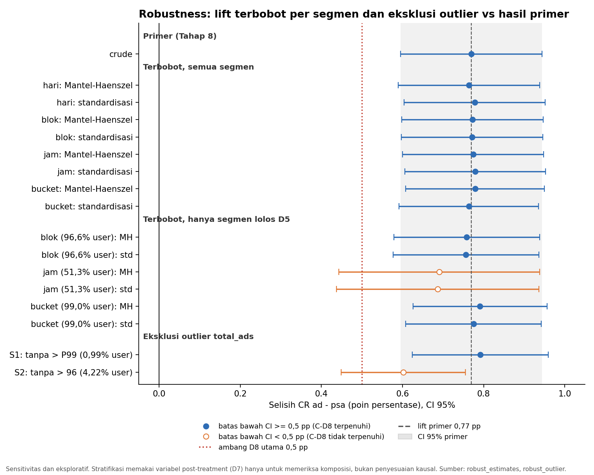

# 11 — Segment Comparison & Robustness Analysis

> Pendamping: `sql/11_segment_robustness.sql` · Tahap 12 (Jalur Lanjutan)
> Seluruh isi dokumen ini adalah **sensitivitas dan eksploratif**. Hasil primer tetap Tahap 8 (`docs/07_ab_testing.md`) dan tidak digantikan. Stratifikasi memakai variabel post-treatment (D7) hanya untuk memeriksa **komposisi**, bukan sebagai penyesuaian kausal.

## Input

- `marketing_ab_clean` (Valid Analysis Population = 588.101 user; 564.577 `ad` dan 23.524 `psa`); hasil primer `ab_primary` (Tahap 8).
- Segmen: 7 hari, 4 blok waktu, 24 jam, dan 5 bucket paparan (D4); aturan sel kecil D5; tanpa uji heterogenitas (D6).

## Proses Analisis

1. **Pemeriksaan Simpson's paradox dan komposisi.** Lift gabungan (crude) dibandingkan dengan lift terbobot per segmen pada empat dimensi, memakai dua estimator:
   - **Standardisasi** ke komposisi gabungan: $\sum_k w_k\,RD_k$ dengan $w_k = N_k/N$.
   - **Mantel–Haenszel risk difference** (varians Greenland–Robins; rumusnya diverifikasi lewat simulasi: rasio SE rumus terhadap SD empiris 0,994, cakupan CI 94,2%).
   - Dua cakupan: **semua segmen** (populasi utuh) dan **hanya segmen yang kedua selnya lolos D5** (bobot dinormalisasi ulang).
2. **Konsistensi arah** selisih antar segmen yang dapat dibaca (deskriptif).
3. **Sensitivitas eksklusi outlier `total_ads`** (dilaporkan, tidak menggantikan primer): S1 = tanpa `total_ads` > P99 gabungan (bucket b5); S2 = tanpa `total_ads` > pagar ekstrem Q3 + 3·IQR (= 96).
4. **Kriteria robustness** (ditetapkan sebelum membaca hasil): C-arah (lift > 0), C-sig (batas bawah CI > 0), C-D8 (batas bawah CI ≥ 0,5 pp).
5. Register analisis, register keterbatasan, dan 15 pemeriksaan rekonsiliasi.

## Temuan

### 1. Komposisi segmen tidak mengubah lift keseluruhan (tidak ada tanda Simpson's paradox)

Lift primer (crude): **0,7692 pp** (95% CI 0,5951 sampai 0,9434).

| Dimensi (semua segmen) | Estimator | Lift (pp) | 95% CI | Selisih vs crude (pp) | % |
|---|---|---:|---|---:|---:|
| Hari (7) | Mantel–Haenszel | 0,7639 | 0,5898 – 0,9380 | −0,0054 | −0,70 |
| Hari | Standardisasi | 0,7777 | 0,6036 – 0,9518 | +0,0085 | +1,10 |
| Blok waktu (4) | Mantel–Haenszel | 0,7724 | 0,5984 – 0,9465 | +0,0032 | +0,41 |
| Blok waktu | Standardisasi | 0,7716 | 0,5974 – 0,9458 | +0,0024 | +0,31 |
| Jam (24) | Mantel–Haenszel | 0,7741 | 0,6001 – 0,9481 | +0,0049 | +0,64 |
| Jam | Standardisasi | 0,7790 | 0,6053 – 0,9527 | +0,0097 | +1,26 |
| Bucket paparan (5) | Mantel–Haenszel | 0,7788 | 0,6080 – 0,9495 | +0,0095 | +1,24 |
| Bucket paparan | Standardisasi | 0,7635 | 0,5915 – 0,9355 | −0,0058 | −0,75 |

Pada keempat dimensi dan kedua estimator, lift terbobot berbeda dari crude **kurang dari 0,01 pp (di bawah 1,3%)**. Perbedaan komposisi hari, jam, dan paparan antar grup (temuan EDA) **tidak** menggeser selisih keseluruhan secara material, dan arahnya tidak berbalik.

> Catatan CI pada dimensi jam: banyak sel `psa` kecil (beberapa dengan 0 konversi), sehingga varians Wald pada cakupan "semua segmen" dapat terlalu sempit dan hanya indikatif.

### 2. Hanya segmen yang lolos D5 (bobot dinormalisasi ulang)

| Dimensi | Estimator | Segmen | User tercakup | Lift (pp) | 95% CI | Selisih vs crude (pp) |
|---|---|---:|---:|---:|---|---:|
| Hari | MH / standardisasi | 7 | 100% | 0,7639 / 0,7777 | tidak berubah | −0,0054 / +0,0085 |
| Blok waktu | MH | 3 | 96,63% | 0,7583 | 0,5789 – 0,9377 | −0,0109 |
| Blok waktu | Standardisasi | 3 | 96,63% | 0,7563 | 0,5764 – 0,9363 | −0,0129 |
| Jam | MH | 7 | **51,25%** | 0,6906 | 0,4432 – 0,9380 | −0,0787 |
| Jam | Standardisasi | 7 | **51,25%** | 0,6866 | 0,4374 – 0,9357 | −0,0827 |
| Bucket paparan | MH | 4 | 99,01% | 0,7911 | 0,6258 – 0,9564 | +0,0218 |
| Bucket paparan | Standardisasi | 4 | 99,01% | 0,7748 | 0,6074 – 0,9422 | +0,0056 |

Untuk **jam**, hanya 7 jam (11–16 dan 18) yang kedua selnya lolos D5, sehingga cakupannya hanya 51,25% user. Estimasi ini adalah estimasi pada **subpopulasi** dan tidak sebanding langsung dengan crude keseluruhan; CI-nya juga lebih lebar karena sampel setengahnya.

### 3. Konsistensi arah selisih antar segmen (segmen yang dapat dibaca)

| Dimensi | Segmen dapat dibaca | Positif | Negatif | Rentang selisih (pp) | Segmen negatif |
|---|---:|---:|---:|---|---|
| Hari | 7 dari 7 | 7 | 0 | +0,14 sampai +1,60 | – |
| Blok waktu | 3 dari 4 | 3 | 0 | +0,68 sampai +0,86 | – |
| Jam | 7 dari 24 | 7 | 0 | +0,23 sampai +1,25 | – |
| Bucket paparan | 4 dari 5 | 2 | **2** | −0,07 sampai +6,94 | b1, b2 |

Arah selisih positif di semua hari, blok, dan jam yang dapat dibaca. Pada bucket paparan, b1 dan b2 sedikit negatif (−0,03 dan −0,07 pp; interval Wilson tumpang tindih pada Tahap 10), sedangkan b3 dan b4 positif besar. Ini menegaskan temuan Tahap 10: selisih terkonsentrasi di paparan sedang-tinggi dan pada bucket paparan rendah kedua grup hampir sama.

### 4. Sensitivitas eksklusi outlier `total_ads` (dilaporkan, tidak menggantikan primer)

| Skenario | n `ad` | Konv `ad` | n `psa` | Konv `psa` | CR `ad` | CR `psa` | Lift (pp) | 95% CI | p-value |
|---|---:|---:|---:|---:|---:|---:|---:|---|---:|
| S0: tanpa eksklusi (primer) | 564.577 | 14.423 | 23.524 | 420 | 2,5547% | 1,7854% | 0,7692 | 0,5951 – 0,9434 | 1,71 × 10⁻¹³ |
| S1: tanpa > P99 gabungan (b5) | 559.017 | 13.554 | 23.274 | 380 | 2,4246% | 1,6327% | 0,7919 | 0,6242 – 0,9596 | 9,54 × 10⁻¹⁵ |
| S2: tanpa > pagar ekstrem (96) | 540.847 | 10.346 | 22.429 | 294 | 1,9129% | 1,3108% | 0,6021 | 0,4489 – 0,7554 | 8,54 × 10⁻¹¹ |

| Skenario | User dikeluarkan | Konversi dikeluarkan | Perubahan lift |
|---|---:|---:|---|
| S1 | 5.810 (0,99%) | 909 | +0,0226 pp (+2,94%) |
| S2 | 24.825 (4,22%) | 4.203 (sekitar 28,3% dari semua konversi) | **−0,1671 pp (−21,73%)** |

- **S1:** menghilangkan 1% user dengan paparan tertinggi tidak mengubah kesimpulan; lift sedikit naik.
- **S2:** lift turun menjadi 0,60 pp. Arah tetap positif dan tetap signifikan (p ≈ 8,5 × 10⁻¹¹), tetapi batas bawah CI (0,449 pp) turun **di bawah 0,5 pp**, sehingga pada ambang D8 utama hasilnya menjadi *inconclusive*. Pada ambang 0,25 pp efeknya masih di atas ambang.
- S2 membuang 4,2% user yang menghasilkan sekitar 28% konversi, karena pagar 96 memotong sebagian besar bucket b4 (58–202), yaitu tempat selisih `ad` − `psa` terbesar (Tahap 10: +6,94 pp). Penurunan lift pada S2 **sejalan** dengan temuan bahwa selisih terkonsentrasi di paparan sedang-tinggi dan bukan tanda bahwa hasil dibuat oleh outlier. Nilai-nilai itu juga bukan kesalahan data (minimum 1, semua bilangan bulat; lihat EDA).

### 5. Verdict robustness

| Kriteria | Terpenuhi |
|---|---|
| C-arah (lift > 0) | **18 dari 18** |
| C-sig (batas bawah CI > 0) | **18 dari 18** |
| C-D8 (batas bawah CI ≥ 0,5 pp) | **15 dari 18** |

Tiga yang tidak memenuhi C-D8: (1) jam, hanya segmen D5-ok, Mantel–Haenszel (batas bawah 0,443); (2) jam, hanya segmen D5-ok, standardisasi (0,437); (3) S2, eksklusi di atas pagar ekstrem (0,449). Pada ketiganya, titik estimasi (0,60–0,69 pp) masih di atas 0,5 pp dan batas bawah CI hanya sedikit di bawahnya. Ketiganya adalah kasus subpopulasi (separuh sampel) atau uji stres yang membuang sekitar 28% konversi.

**Kesimpulan otomatis skrip:** arah dan signifikansi tidak berubah pada seluruh estimator dan skenario; kesimpulan practical significance (batas bawah CI ≥ 0,5 pp) berubah pada tiga kasus di atas.

### 6. Rekonsiliasi

15 dari 15 pemeriksaan **PASS** (ALL PASS): SUM(n) dan SUM(konversi) per dimensi = Tahap 8; pada dimensi satu strata, standardisasi dan Mantel–Haenszel sama dengan crude (lift dan SE); S0 = hasil primer (lift dan p-value); jumlah user yang dikeluarkan S1 = bucket b5 pada Tahap 10; n per segmen cocok dengan Tahap 10 dan 11; identitas $\sum_k (n_{ad,k}/n_{ad})\,CR_{ad,k} = CR_{ad}$; dan setiap estimator memuat estimasinya sendiri di dalam CI-nya.

## Interpretasi

1. **Kesimpulan utama diperiksa terhadap bias komposisi dan tidak berubah.** Mengontrol komposisi hari, blok, jam, atau paparan menggeser lift keseluruhan kurang dari 0,01 pp, dan tidak ada pembalikan arah. Tidak ada tanda Simpson's paradox.
2. **Arah konsisten, besar efek tidak seragam.** Arah positif di semua hari, blok, dan jam yang dapat dibaca. Besar selisih bervariasi (0,14 sampai 1,60 pp antar hari; −0,07 sampai +6,94 pp antar bucket paparan). Perbedaan ini **tidak diuji secara formal** dan **tidak otomatis menjadi bukti efek interaksi** (D6).
3. **Practical significance pada ambang 0,5 pp lebih sensitif daripada signifikansi statistik.** Signifikansi statistik dan arah bertahan di semua 18 pemeriksaan, tetapi pada tiga kasus (separuh sampel atau pembuangan sekitar 28% konversi) batas bawah CI berada sedikit di bawah 0,5 pp. Ambang 0,5 pp sendiri adalah asumsi (D8).
4. **Batas kausal.** Stratifikasi memakai variabel post-treatment (D7) dan hanya memeriksa komposisi. Hasil di dokumen ini menjelaskan *apa yang terjadi* dan *di mana*, dan tidak membuktikan bahwa paparan, hari, atau jam menyebabkan konversi. Primary test hanya mendukung interpretasi efek penugasan grup jika randomization valid, dan itu tidak dapat diverifikasi dari dataset.

## Register analisis: konfirmatori vs eksploratif

| No | Tahap | Analisis | Jenis | Keputusan terkait |
|---:|---|---|---|---|
| 1 | 6 | KPI Lock, validasi populasi dan struktur | Konfirmatori (definisi terkunci) | D1–D9 |
| 2 | 8 | Uji primer: z-test dua arah, CI 95% selisih, relative lift | Konfirmatori (primary) | D1, D2 |
| 3 | 8 | Sensitivitas: chi-square, Fisher exact, eksklusi duplikat | Konfirmatori (sensitivitas) | D2, D3 |
| 4 | 8 | MDE retrospektif dan practical significance | Konfirmatori (kecukupan desain) | K4, D8, D9 |
| 5 | 9 | Ringkasan performa keseluruhan dan scorecard bukti | Ringkasan atas hasil konfirmatori | D8, D9 |
| 6 | 7 | EDA: distribusi, keseimbangan antar grup | Eksploratif | D7 |
| 7 | 10 | CR per bucket paparan, tren, dekomposisi | Eksploratif (post-treatment) | D4–D7 |
| 8 | 11 | Uji lift per hari (7) dan blok (4), Holm | Eksploratif (dikoreksi Holm) | D5, D6, K2 |
| 9 | 11 | CR per jam (24) | Eksploratif (deskriptif, tanpa uji) | D5, D6, K3 |
| 10 | 12 | Standardisasi, Mantel–Haenszel, konsistensi arah | Sensitivitas (pemeriksaan komposisi) | D5–D7 |
| 11 | 12 | Eksklusi outlier `total_ads` ekstrem | Sensitivitas (tidak menggantikan primer) | D4, D9 |

## Register keterbatasan (limitations register)

| ID | Kategori | Keterbatasan | Dampak | Penanganan |
|---|---|---|---|---|
| L01 | Desain | Randomization tidak dapat diverifikasi (tidak ada metadata randomization) | Interpretasi selisih CR sebagai efek penugasan grup bersyarat pada randomization yang valid | Dinyatakan di setiap kesimpulan (Tahap 8, 9, 12) |
| L02 | Desain | Rasio grup `ad` : `psa` ± 24 : 1, rasio desain tidak diketahui | SRM tidak dapat dinilai; grup `psa` kecil (23.524) membatasi MDE dan sel segmen | Rasio dilaporkan deskriptif; MDE retrospektif (K4); sel kecil (D5) |
| L03 | Data | Tidak ada data biaya atau nilai transaksi | Tidak ada klaim ROI, ROAS, atau profit; ambang practical significance tidak dapat diturunkan dari biaya | Ambang D8 dinyatakan sebagai asumsi eksplisit |
| L04 | Data | `total_ads`, hari, dan jam adalah variabel post-treatment (satu nilai per user) | Asosiasi, bukan sebab-akibat; bukan hari atau jam konversi | D7; stratifikasi hanya untuk memeriksa komposisi |
| L05 | Data | Tidak ada timestamp assignment atau konversi | Tidak ada time-to-convert, novelty effect, tren kalender, atau urutan paparan dan konversi | Dicatat sebagai limitation |
| L06 | Statistik | Banyak sel segmen `psa` kecil (17 dari 24 sel jam, blok 00–05, bucket b5) | Rate sel kecil tidak diinterpretasikan dan tidak diuji | D5, K1, K2; cakupan "D5-ok" pada Tahap 12 |
| L07 | Statistik | Pengujian berulang pada segmen (7 hari, 4 blok) | Risiko temuan positif palsu; CI selisih per segmen tidak disesuaikan | Holm per family (D6); berlabel eksploratif; tanpa uji interaksi |
| L08 | Statistik | Ambang practical significance D8 (0,25 / 0,5 / 1,0 pp) adalah asumsi | Verdict practical significance bergantung pada ambang | Tabel sensitivitas tiga ambang (Tahap 8, 9, 12) |
| L09 | Generalisasi | Satu eksperimen dalam satu periode pada populasi dataset | Tidak digeneralisasi ke populasi atau periode lain | Dinyatakan di kesimpulan |
| L10 | Data | Definisi operasional konversi dan sumber dataset hanya dapat dirujuk ke dokumentasi Kaggle | Kebenaran substantif outcome tidak dapat diaudit | Dicatat sebagai asumsi (`docs/assumptions.md`) |
| L11 | Publikasi | Lisensi dataset belum diverifikasi | Risiko kepatuhan saat publikasi | **Wajib dicek dan dicantumkan di README sebelum publish (Tahap 17–18)** |

## Output

- Tabel `robust_strata`, `robust_estimates`, `robust_direction`, `robust_outlier`, `robust_verdict`, `robust_conclusion`, `analysis_register`, `limitations_register`, `robust_checks` di `ab_testing.duckdb`.
- `sql/11_segment_robustness.sql`, dokumen ini, dan `docs/figures/robust_01_forest.png` (gambar statis dari hasil SQL).

## Assumptions

- Kriteria robustness (C-arah, C-sig, C-D8) adalah aturan pelaporan yang ditetapkan sebelum membaca hasil; bukan keputusan statistik baru dan tidak mengubah D1–D9.
- Pagar ekstrem S2 dan batas P99 S1 dihitung dari populasi gabungan; kedua skenario dilaporkan berdampingan dengan hasil primer dan tidak menggantikannya.
- Ambang D8 0,5 pp adalah asumsi eksplisit.

## Batasan data

- Variabel stratifikasi adalah post-treatment; hasil bersifat pemeriksaan komposisi, bukan penyesuaian kausal.
- Pada dimensi jam hanya 7 dari 24 segmen yang lolos D5 (51% user); CI pada cakupan "semua segmen" untuk jam hanya indikatif.
- Tidak ada uji heterogenitas atau interaksi; perbedaan besar efek antar segmen tidak boleh dibaca sebagai efek interaksi yang terbukti.
- Randomization tidak dapat diverifikasi dan rasio grup ± 24 : 1.

## Kesimpulan

Kesimpulan utama tahan terhadap pemeriksaan komposisi dan eksklusi outlier. Lift terbobot per hari, blok, jam, dan bucket paparan berbeda kurang dari 0,01 pp dari lift primer 0,77 pp, arah selisih positif di semua hari, blok, dan jam yang dapat dibaca, dan arah serta signifikansi bertahan pada 18 dari 18 pemeriksaan. Satu-satunya kelemahan adalah kecukupan practical significance pada ambang 0,5 pp: batas bawah CI turun sedikit di bawah 0,5 pp pada tiga kasus (separuh sampel pada analisis jam, dan eksklusi 4,2% user yang menghasilkan sekitar 28% konversi). Besar selisih tidak seragam antar segmen, terutama bucket paparan (hampir nol di paparan rendah, terkonsentrasi di paparan sedang-tinggi), dan itu tidak diinterpretasikan sebagai efek interaksi. Seluruh batas kausal tetap berlaku: randomization tidak dapat diverifikasi, tidak ada data biaya, dan segmen berbasis variabel post-treatment hanya bersifat asosiatif.

Dengan ini Jalur Lanjutan (Tahap 10–12) selesai.
